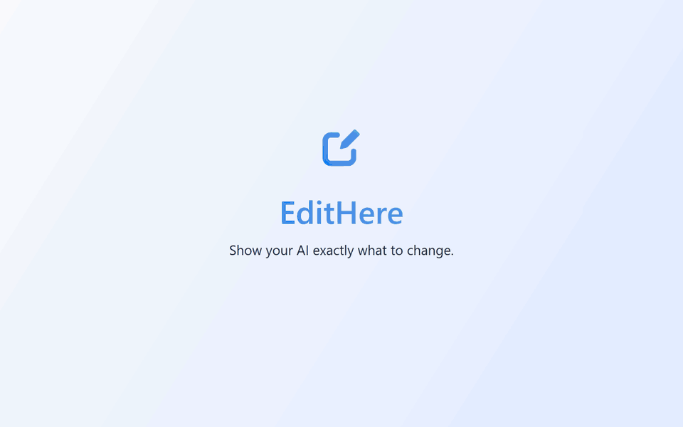
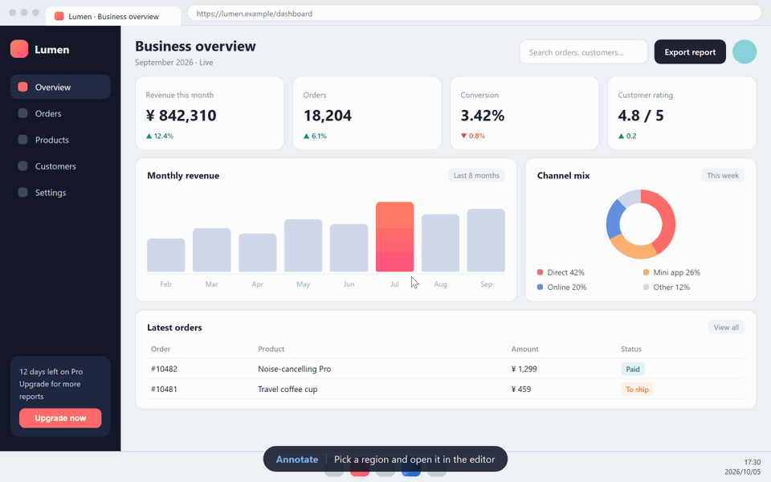
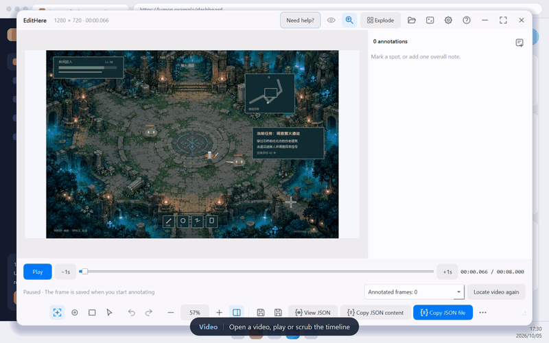
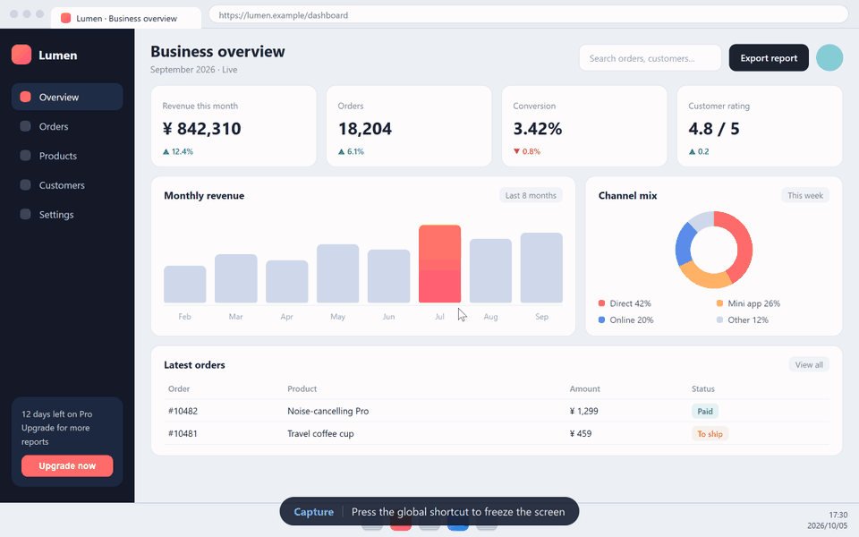
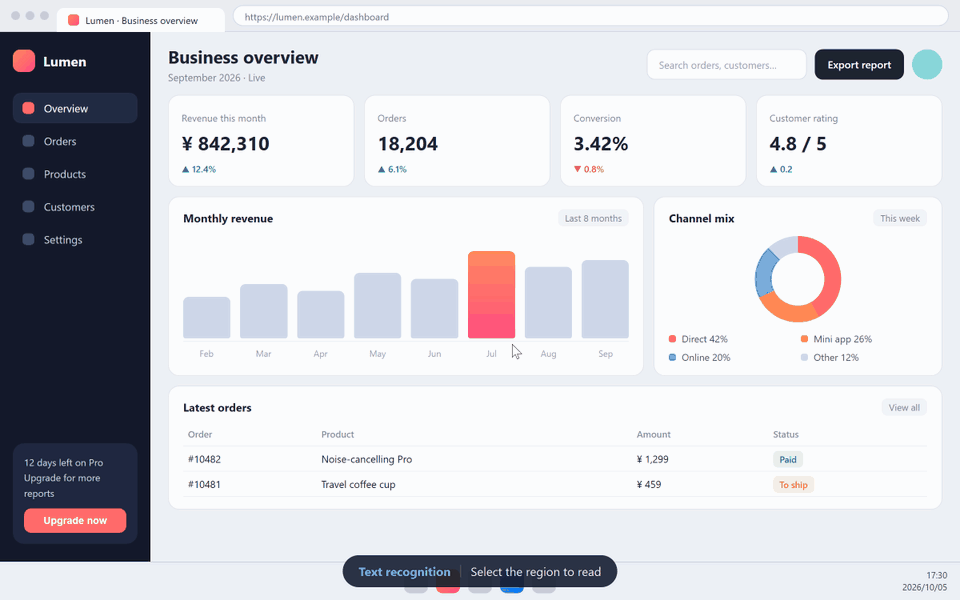
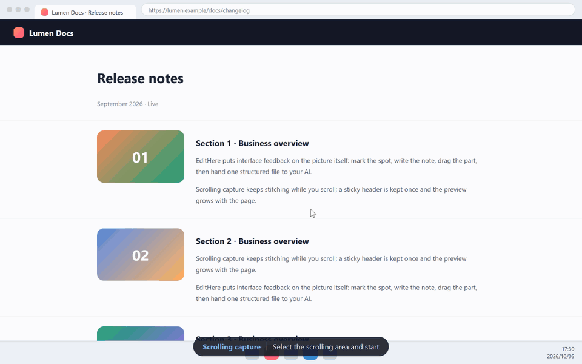

<p align="center">
  
</p>
<h1 align="center"><picture><source media="(prefers-color-scheme: dark)" srcset="assets/brand/edithere-wordmark-light.svg"></picture></h1>
<p align="center"><b>EditHere</b> — show your AI exactly what to change.</p>
<p align="center">A general-purpose visual annotation and layout tool for working with AI.<br>Pick out elements, drag the layout into place, or pause a video and leave notes — turning “change <i>this</i>, <i>here</i>” into <b>an untouched original + pixel coordinates + layout changes</b> that any multimodal AI can act on.<br><sub>Web · desktop and game UI · AI images · video and animation</sub></p>

<p align="center">
  <a href="https://github.com/Inginnng/EditHere/releases/latest"></a>
  <a href="https://github.com/Inginnng/EditHere/releases"></a>
  
  <a href="LICENSE"></a>
  <a href="https://github.com/Inginnng/EditHere/stargazers"></a>
</p>

<p align="center"><a href="https://hellogithub.com/repository/Inginnng/EditHere" target="_blank"></a></p>

<p align="center">
  <a href="#download-and-install"><b>Download</b></a> ·
  <a href="#set-up-with-ai">Set up with AI</a> ·
  <a href="#features">Features</a> ·
  <a href="#how-is-this-different-from-screenshot-markup">Vs. screenshot markup</a> ·
  <a href="#desktop-and-web-editions">Desktop and web</a> ·
  <a href="docs/AGENT-CLI.en.md">AI integration</a> ·
  <a href="docs/USER-GUIDE.en.md">User guide</a> ·
  <a href="https://github.com/Inginnng/EditHere/releases">Release notes</a>
</p>
<p align="center"><a href="README.md">简体中文</a> · <b>English</b></p>

<p align="center">
  
</p>
<p align="center"><sub>↑ The agent starts a review → you leave your notes in EditHere → “Finish and return to AI” → the agent reads the feedback and makes the changes</sub></p>

## Why EditHere?

“Move the button in the top-right a bit to the left.” “Make that card bigger.” “This colour is off.” When you iterate on an interface with AI, you know exactly what you want — yet you spend paragraphs describing **where** and **how much**, and the AI still edits the wrong thing.

**EditHere puts your feedback on the picture itself.** Mark a region, write a note, or drag a part to where it belongs. EditHere packs the original image, the coordinates of every note and every layout change into one JSON file for Codex, Claude Code, WorkBuddy, Qcode or any other AI tool.

It binds to no model and no DOM: if you can see it on screen, you can annotate it.

|                         | Describing it in text                  | With EditHere                                                  |
| ----------------------- | -------------------------------------- | -------------------------------------------------------------- |
| **Point at something**  | “the button near the top right”        | One click, exact pixel coordinates                             |
| **Change the layout**   | “move it left a bit, ~20% bigger”      | Drag and resize; real before/after coordinates are recorded    |
| **Many changes at once**| One long message, easy to miss things  | Every note is numbered and tied to its spot on the image       |
| **Video / animation**   | “around second 3”                      | Pause on the frame; each note carries a timestamp and the frame |
| **Hand it to AI**       | Paste a screenshot, then type          | The AI opens the image via the CLI and receives your feedback when you click Finish |

### Where it fits

- **🖥️ Web, desktop and game interfaces.** Browser pages, Qt / WPF / Electron apps, mobile emulators, Canvas and game HUDs. No DOM parsing required — if it is on screen, it can be marked.
- **🎨 Retouching AI-generated images.** Flag a dozen details on one image at once, or drag an element to its new place and re-render from the original instead of painting over it again and again.
- **🎬 Video and animation reviews.** Load an MP4 / MOV / WebM, pause on the broken frame, and export a list with timestamps and frame captures.
- **📐 Design-to-implementation checks.** With coordinate readouts, colour picking and scrolling capture, turn the gap between design and build into concrete numbers for your AI.

## How is this different from screenshot markup?

The three common approaches each stop somewhere; EditHere covers what none of them reach:

|  | Screenshot + boxes<br>*(chat apps, Snipaste, …)* | DOM annotation<br>*(Codex / WorkBuddy side panes)* | Inpainting<br>*(paint over, redraw)* | **EditHere** |
| :--- | :--- | :--- | :--- | :--- |
| **Original** | Boxes and labels are baked into the pixels, hiding detail | Left untouched | Painted area overwrites the original | Fully preserved; notes and coordinates live in JSON |
| **Many notes** | Boxes and text overlap; the AI misreads them | One node at a time, no shared list | One spot plus one prompt per pass | One number per note, matched to coordinates |
| **Scope** | Anything on screen | Only pages with a parseable DOM | A single still image | Web, native apps, games, video, generated images |
| **Moving** | Arrow plus words — no distance, no scale | Free-coordinate moves are hard to express | Not supported | **Explode** drags and resizes, recording both rectangles |
| **Handoff** | Image plus typing | The tool turns nodes into prose | Re-generates the whole image | Structured JSON + original; fully automatic with the skill / CLI |

**DOM annotation** is the approach people ask about most — the page markup in Codex and WorkBuddy side panes, and browser annotation plugins such as Agentation. They are excellent on the web, but the moment the picture leaves the DOM — a game, a desktop app, a video, a generated image — they have nothing to hold on to. Boxes on a screenshot, meanwhile, fall apart as soon as you need more than two of them.

## Features

### ✍️ Annotate: points, boxes, smart select and global notes

**Smart select** a detected element and write your note, scrolling the wheel to widen or narrow the candidate; drop a **point** on an exact pixel; drag a **box** around any area; add a **global note** about the whole picture. Each note is numbered and tied to its location, and the whole set exports as JSON in one click.

Your notes are never drawn into the image: markers can be hidden at any time, so the AI always receives a clean original plus separate coordinates.

<p align="center"></p>

### 💥 Explode: drag the layout you want

One drag beats a paragraph. **Explode** splits the picture into rectangular parts you can move and resize on their own — **drag them, scale them proportionally, or type exact coordinates**, and `Ctrl`-click to move a group together.

Every move or resize becomes a note recording the region **before and after**; the old spot is left empty (shown as a transparency checkerboard), and your AI decides whether to fill the background or reflow the layout. A hundred times more precise than “move it left a bit”.

<p align="center"></p>

### 🎬 Annotate video by timestamp

Open a video, play or scrub the timeline, and **pause on the frame you want to change** to annotate it; play on and annotate another moment. Tags on the timeline bring annotated frames back at any time. In the exported JSON every note carries its timestamp and frame screenshot — ideal for reviewing animations, games and interaction flows.

Only frames you actually annotated are exported; simply pausing never produces an empty frame.

<p align="center"></p>

See the [video annotation guide](docs/VIDEO-ANNOTATION.en.md) for the format.

### 🤖 Hand it to your AI

EditHere provides structured feedback, with an optional API feature that turns annotations into plain text:

- **Manually:** copy JSON text, JSON and its companion image, or an annotated image and paste it into any AI.
- **Automatically:** with the [`edithere` skill](skills/edithere/SKILL.md) and `edithere-cli` from this repository, the AI runs `edithere-cli annotate`, EditHere opens the picture, and the moment you click **“Finish and return to AI”** the AI receives your feedback and carries on. Cancelling or timing out never turns unsubmitted edits into change requests.
- **Plain text (0.13.0):** choose a provider and save your own key under **Settings → AI API**, then use **More → Generate instructions**. A separate API request interprets the screenshots and annotations; review the result and copy only text to the target agent, reducing image context in that conversation. See [Generate instructions](docs/AI-INSTRUCTIONS.en.md).

File handoff defaults to JSON with a companion original; **Embed original image in JSON** enables one-file handoff. **Copy JSON content** omits image bytes by default and the vertical **⋯** menu inside the button remembers a separate choice. New readers accept older feedback and projects; older apps are not guaranteed to read v4.

### 🖼️ Capture, smart select and pins

Press the global shortcut to freeze the screen. **Hover to get candidate regions**, scroll the wheel to widen or narrow the selection, or drag your own box. Once the region is settled, a toolbar appears above it — annotate, text recognition, scrolling capture, pin, save, copy — with corners, shadow and border in the style column beside it. Changes show up immediately, pins stay on top, and you can pin as many as you like.

<p align="center"></p>

<details>
<summary>Magnifier, colour picker, capture history and more</summary>

- While dragging, a **magnifier** follows the pointer with pixel coordinates and `RGB` / `HEX` / `HSV` / `HSL` readouts; press `C` to pick and copy a colour.
- Arrow keys move the pointer one pixel at a time; `Shift` / `Ctrl` + arrows shrink or grow the region by one pixel.
- Fixed ratios (1:1, 4:3, 16:9, 9:16, custom); click the size to type an exact width and height.
- The last 20 captures and 10 selections persist across sessions: `<` / `>` browse history, `R` restores the last selection.
- Pins can be resized, rotated, flipped, made translucent, and sent straight to the editor from their context menu.

See [User guide · Capture](docs/USER-GUIDE.en.md#capture) for every shortcut.
</details>

### 🔤 Text recognition (OCR)

Select a region to read its text. Results are listed **line by line**; pick a line to highlight it on the image, then copy one line or all of them. It uses the system's own engine (Windows OCR / macOS Vision): **offline, nothing uploaded, no extra dependencies**.

When you add a note, EditHere also reads the text inside that region locally and attaches it to the feedback, so the AI can confirm what it is looking at.

<p align="center"></p>

### 📜 Scrolling capture

Select a scrolling area and choose **Scrolling capture**. EditHere stitches while you scroll, the preview beside the region grows with the page, and sticky headers are kept only once. It captures in both directions, can scroll for you, trims with one click, and finishes straight into annotation.

<p align="center"></p>

### And also

| | |
| --- | --- |
| 💾 **Projects** | `.edithere` projects embed the image, notes and editing state so you can pick up where you left off; video projects reference the source file and keep annotated frames. |
| 📥 **Any input** | Capture, open, drop or paste PNG / JPEG / WebP / BMP, and MP4 / MOV / WebM videos. |
| 🎨 **Your way** | Light and dark themes, English and Simplified Chinese interface, 22 configurable shortcuts and a customisable toolbar. |
| 🔒 **Local first** | Capture, element detection, OCR and editing run on your machine. The optional API generation feature sends this task's images and annotations to your chosen provider. |
| 🖥️ **Cross-platform** | Windows 10 1809+ is fully supported; macOS 14+ and Linux (Ubuntu 24.04) are previews. |

## Desktop and web editions

Same annotation and Explode model, two ways to run it: **the desktop app is the workhorse** — capture, video, scrolling capture and an automatic loop with local agents. **The web edition is a single HTML file** — double-click it, host it on any static site, and the material never leaves your machine.

| Capability | 💻 Desktop | 🌐 Web |
| :--- | :--- | :--- |
| **Best for** | Daily use, one shortcut away on any screen, the full feature set, tight loops with local AI tools | Nothing to install, out of the way, works as the annotation pane on the right of WorkBuddy / Codex and other AI workbenches |
| **Image annotation** (points / boxes / smart select / global) | ✅ | ✅ |
| **💥 Explode moves and resizes** | ✅ | ✅ (no table-hierarchy detection yet; draw the region yourself if it is missed) |
| **🎬 Video annotation by timestamp** | ✅ | ✅ (depends on the browser's decoders; annotated frames only, not a video editor) |
| **Global shortcut capture** | ✅ `Alt + Shift + 2` freezes the screen and starts selecting | ❌ Browsers cannot capture other apps |
| **System OCR and region text** | ✅ Reads the text inside your selection automatically | ⚠️ Can import and edit existing results; no automatic reading |
| **Scrolling capture / pins / tray** | ✅ | ❌ Desktop-only |
| **Automatic loop with AI** | ✅ skill + `edithere-cli`; Finish sends the feedback back | ✅ Embedded via MCP Apps, or a local `web/agent.cjs` session |
| **Project files** | `.edithere` | `.edithere-web.json` (its own format; feedback import and export) |
| **Offline** | ✅ Fully offline | ✅ One HTML file, no server, no CDN |

To get the web edition, download and unzip [EditHere-web.zip](https://github.com/Inginnng/EditHere/releases/latest/download/EditHere-web.zip), then open `EditHere.html`; or host that file on any static site. For agent integration use `EditHere-web-agent.zip` — see the [web edition guide](web/README.en.md).

## Set up with AI

Paste the matching prompt into an AI tool that can use your local terminal and files, such as Codex or Claude Code:

Desktop app:

```text
Follow https://github.com/Inginnng/EditHere/blob/codex/native/docs/AI-SETUP.en.md to set up EditHere and the edithere skill for me.
Reuse an existing installation or fully extracted ZIP package first; otherwise, install the appropriate version for my operating system.
Verify that the CLI works and the skill is in a location recognized by my current AI tool, then explain how to start my first annotation session.
Tell me when a system permission prompt requires my action.
```

Web edition (MCP Apps or the browser-compatible entry point):

```text
Follow https://github.com/Inginnng/EditHere/blob/codex/native/web/AI-SETUP.en.md to install EditHere Web Agent for me.
I will provide the web-agent ZIP location, or a local file plus its SHA-256: check for an existing install first, then extract the whole archive into a long-lived user directory.
Prefer configuring the EditHere Web MCP for my current host, verify tool discovery and the embedded UI, and install the edithere-web skill.
If the host does not support MCP Apps, explain the actual limitation and use the browser-compatible entry point instead.
Keep existing settings and do not overwrite other MCP servers or skills; finish by telling me how to annotate the current page.
```

Then, inside your project, just say:

> Let me mark up the home page in EditHere, and apply my notes when I'm done.

The desktop app needs an AI tool with access to your local terminal and files; the web edition also needs a host that supports MCP Apps, and falls back to the browser-compatible entry point when it does not. A web chat alone cannot install software on your computer. See the [AI setup guide](docs/AI-SETUP.en.md) and the [web setup guide](web/AI-SETUP.en.md).

## Download and install

| Platform | Download | Notes |
| --- | --- | --- |
| **Windows x64 · Recommended** | [EXE installer](https://github.com/Inginnng/EditHere/releases/latest/download/EditHere-win-x64-setup.exe) | Per-user install, no administrator rights; Start menu entry, uninstaller and project file association. |
| **Windows x64 · Portable** | [ZIP archive](https://github.com/Inginnng/EditHere/releases/latest/download/EditHere-win-x64.zip) | Extract the whole archive and run `EditHere.exe`; keep the DLLs and plugin folders beside it. |
| **macOS · Apple Silicon / Intel** | [Universal DMG](https://github.com/Inginnng/EditHere/releases/latest/download/EditHere-macos-universal.dmg) | Drag `EditHere.app` into Applications; grant Screen Recording before the first capture. |
| **Linux x86_64 · Preview** | [AppImage](https://github.com/Inginnng/EditHere/releases/latest/download/EditHere-linux-x86_64.AppImage) | Make it executable and run it; targets Ubuntu 24.04. See the [Linux guide](docs/LINUX.en.md). |
| **Web · No install** | [Web archive](https://github.com/Inginnng/EditHere/releases/latest/download/EditHere-web.zip) | Unzip and open `EditHere.html`, or host it on a static site; see the [web edition guide](web/README.en.md). |

These links always point to the latest public release; check the [Releases](https://github.com/Inginnng/EditHere/releases) page and the package's `version.txt` for its version.

<details>
<summary>Installation details, platform notes and upgrading</summary>

- The Windows installer defaults to `%LOCALAPPDATA%\Programs\EditHere`. Its components page offers launch at login, adding the CLI to PATH and a desktop shortcut; launch at login and PATH are selected on a new install, and upgrades keep the existing startup registration. Reopen your terminal and AI tools afterwards so they pick up the new PATH. Uninstalling keeps your settings and projects.
- The Windows installer is **not yet code-signed**. Download it from this repository's Releases and verify the [SHA-256 checksums](https://github.com/Inginnng/EditHere/releases/latest/download/SHA256SUMS.txt).
- The minimum Windows target is Windows 10 1809+, developed and tested on Windows 11. The portable ZIP needs no separate Qt, Python, Node or .NET.
- macOS requires 14+ and **is still a preview, without acceptance testing on a physical Mac or Apple notarization**; the scrolling capture backend compiles in the macOS build.
- Linux preview: under Wayland, authorise a monitor first, then select the region in EditHere for manual scrolling capture; without PipeWire or ScreenCast support it falls back to the system region picker for ordinary screenshots. X11 supports manual capture and automatic vertical scrolling. See the [Linux guide](docs/LINUX.en.md).
- **Upgrading:** quit the old version, then run the installer or extract the new ZIP. If launch at login reports an old path, keep the option selected and save to refresh it; saving a project once registers the `.edithere` file association. Older versions' update checks may not recognise the renamed repository, so use the links above for your first upgrade.

</details>

## Quick start

1. **Install** — let your AI do it with the [prompt above](#set-up-with-ai), or download manually (the web edition is unzip-and-run).
2. **Capture** — press the global shortcut `Alt + Shift + 2`, or ask your AI to “let me mark up the main page in EditHere”.
3. **Annotate** — points, boxes, global notes, Explode; whatever makes your intent clear.
4. **Hand off** — click “Finish and return to AI”, or copy the JSON into any AI tool.

More actions, shortcuts and examples are in the [user guide](docs/USER-GUIDE.en.md).

## Structured feedback JSON

The exported `feedback-minimal-4` keeps image verification, note positions, boxed regions and Explode moves apart, so any agent or workflow can parse it:

```jsonc
{
  "schemaVersion": "feedback-minimal-4",
  "tool": {"name": "EditHere", "version": "0.13.0"},
  "image": {"mode": "file", "file": "feedback.png", "mimeType": "image/png",
            "width": 2000, "height": 1200, "devicePixelRatio": null,
            "sha256": "…"}, // illustrative hash; send the original with this JSON
  "annotationSpace": "result",
  "objects": [
    {"id": "o1", "kind": "region", "source": {"x1": 1002, "y1": 156, "x2": 1464, "y2": 384},
     "annotations": [{"number": 1, "text": "Make the conversion drop stand out with a red tag"}]},
    {"id": "o2", "kind": "region", "source": {"x1": 1760, "y1": 50, "x2": 1960, "y2": 110},
     "movement": {"rect": {"x1": 640, "y1": 40, "x2": 840, "y2": 100}, "dx": -1120, "dy": -10},
     "annotations": [{"number": 2, "text": "Move Export next to the title"}]},
    {"id": "o3", "kind": "global", "annotations": [{"number": 3, "text": "More breathing room overall"}]}
  ]
}
```

Every entry in `objects` is one change: `source` is where it was, `movement` records where Explode put it and by how many pixels, and `annotations` holds your own words. The original ships as a separate file by default, or can be embedded in the JSON instead.

Field reference: [User guide · Feedback JSON](docs/USER-GUIDE.en.md#feedback-json). Commands and examples: [AI integration and CLI](docs/AGENT-CLI.en.md).

## FAQ

<details>
<summary><b>I can already draw a box on a screenshot — why EditHere?</b></summary>

For one or two simple notes, that is enough. Once there are more, boxes and labels overlap and the AI cannot tell which sentence belongs where; and intents like “move this over there and make it bigger” are nearly impossible to express with an arrow and a sentence. EditHere binds every note to its coordinates by number, records moves directly with Explode, and never covers the original. See the [comparison above](#how-is-this-different-from-screenshot-markup).
</details>

<details>
<summary><b>Can it detect every control and all image content?</b></summary>

No. It combines element boundaries exposed by the system with local image analysis to find candidate regions; this is not semantic recognition. When a suggestion doesn't fit, draw the box yourself. Text recognition is a separate action that reads only the region you selected.
</details>

<details>
<summary><b>Are screenshots uploaded?</b></summary>

Not automatically. Capture, detection and editing happen locally. If you use **Generate instructions** or **Test connection**, EditHere calls your configured API: generation sends the current annotation snapshot and screenshots, while the connection test sends only a built-in small image. If you send feedback yourself or let an AI tool read it, any upload depends on that tool. When you check for updates manually or use the default startup check, EditHere queries stable releases on GitHub and [Gitee](https://gitee.com/InnGing/EditHere) and chooses the newer version.
</details>

<details>
<summary><b>Does it only work with Codex or Claude Code?</b></summary>

No. Feedback is plain JSON plus images, tied to no model provider. Codex and Claude Code can use the companion skill; other tools can use the CLI or a manual import. The desktop app also offers optional API generation for OpenAI, Claude, DeepSeek, GLM, Kimi and compatible custom services, using your own API key and credits.
</details>

<details>
<summary><b>Can I use the skill with the portable ZIP?</b></summary>

Yes. Extract the whole Windows ZIP, put the `edithere` skill where your AI tool finds skills, and give the AI the absolute path to `edithere-cli.exe`. No installer and no PATH change needed.
</details>

<details>
<summary><b>Can I save my work and continue later?</b></summary>

Yes. A `.edithere` project keeps the original image, notes and editing state; the JSON you hand to AI carries the change requests of the current session. The web edition saves `.edithere-web.json`, which you can drop back in to continue.
</details>

## Documentation

| Document | What's inside |
| --- | --- |
| [User guide](docs/USER-GUIDE.en.md) | Capture, annotation, Explode, export, settings and shortcuts |
| [AI integration and CLI](docs/AGENT-CLI.en.md) | `edithere-cli` commands, skill setup and agent integration |
| [Generate instructions](docs/AI-INSTRUCTIONS.en.md) | Configure a model API to turn screenshots and annotations into plain text |
| [AI setup guide](docs/AI-SETUP.en.md) | Let an AI install and configure EditHere for you |
| [Web edition guide](web/README.en.md) | The standalone HTML, MCP Apps and the browser-compatible mode |
| [Video annotation](docs/VIDEO-ANNOTATION.en.md) | The video feedback format and workflow |
| [Scrolling capture](docs/LONG-CAPTURE.en.md) | Design and verification of scrolling capture |
| [Linux guide](docs/LINUX.en.md) | AppImage, OCR dependencies and X11 / Wayland behaviour |
| [Build and development](docs/DEVELOPMENT.en.md) | Building from source, tests and packaging |
| [Platforms and distribution](docs/DISTRIBUTION.en.md) | Artefacts and layout for each platform |
| [Full changelog (Chinese)](CHANGELOG.md) | Every change, version by version |

## Contributing and feedback

- [Report a problem or suggest an improvement](https://github.com/Inginnng/EditHere/issues). Please include your OS and app versions, steps to reproduce, and a screenshot or sample project you're comfortable sharing.
- QQ group **1018416966** (feedback only); mention you came from GitHub when joining.
- To contribute code, see the [contributing guide (Chinese)](CONTRIBUTING.md).

## Special thanks

<p align="center">
  <a href="https://linux.do/"></a>
  &nbsp;&nbsp;&nbsp;&nbsp;&nbsp;&nbsp;&nbsp;&nbsp;
  <a href="https://hellogithub.com/repository/Inginnng/EditHere"></a>
</p>

- **[LINUX DO](https://linux.do/)** is a Chinese tech community whose motto is “Where possible begins”. EditHere picked up plenty of suggestions and feedback from the people there, and quite a few details were fixed because of them.
- **[HelloGitHub](https://hellogithub.com/repository/Inginnng/EditHere)** discovers and shares interesting, beginner-friendly open-source projects. EditHere is featured in [issue 127 of the HelloGitHub monthly](https://hellogithub.com/periodical/volume/127).

## A note from the author

I'm Yinji, a student developer.

It started from something simple. With vibe coding, the AI feels like a wishing machine: one sentence and a working screen appears. But the moment a detail needs to change, the idea is perfectly clear — and saying it out loud is the hard part. So I wanted to mark the request right on the picture: which part, how big, move it where. Let the idea be seen first, then built. That is what EditHere grew out of.

Job hunting is taking most of my time right now, so updates come slowly, but they will not stop — several features I have planned are on the way. I hope EditHere becomes a starting point for more tools that rethink how people and AI work together, and for building the best human–AI interaction software I can.

If EditHere helps you, a star on GitHub matters a lot to me. Or just tell me about the problem you hit. Thank you for using it.

## License and commercial collaboration

The original software is licensed under the [PolyForm Noncommercial License 1.0.0](LICENSE) (SPDX: `PolyForm-Noncommercial-1.0.0`).

Personal, educational, research, charitable and government **noncommercial** use is free — just keep the licence text and the `Required Notice`. **Commercial use requires a written licence from the author**, including embedding EditHere in a product or service you sell or charge for. See [commercial licensing (Chinese)](COMMERCIAL-LICENSE.md) or write to **<inginnng@163.com>**.

The EditHere name and marks are not licensed under these terms; see the [trademark policy (Chinese)](TRADEMARK-POLICY.md). Qt, MinGW and other third-party components are covered by their own licences; see the [third-party notices (Chinese)](packaging/THIRD-PARTY-NOTICES.md).

## Star History

<p align="center">
  <a href="https://star-history.com/#Inginnng/EditHere&Date">
    <picture>
      <source media="(prefers-color-scheme: dark)" srcset="https://api.star-history.com/svg?repos=Inginnng/EditHere&type=Date&theme=dark" />
      <source media="(prefers-color-scheme: light)" srcset="https://api.star-history.com/svg?repos=Inginnng/EditHere&type=Date" />
      
    </picture>
  </a>
</p>
