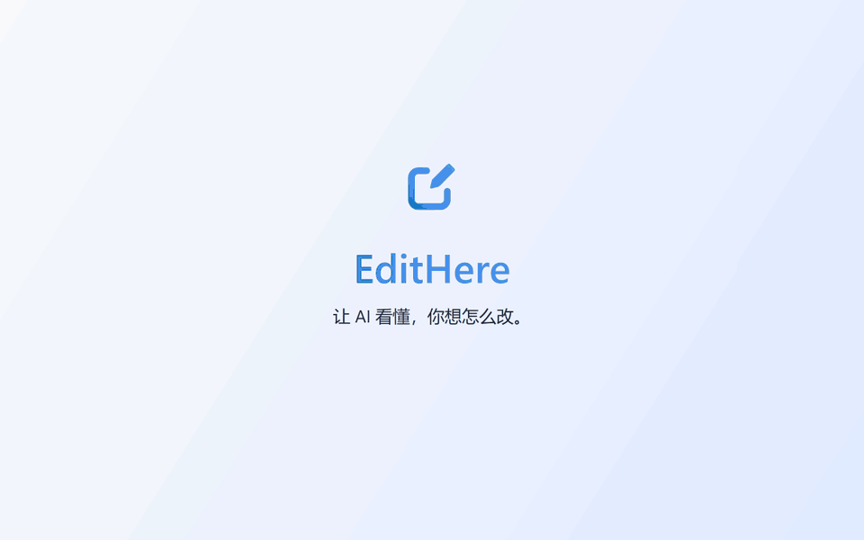
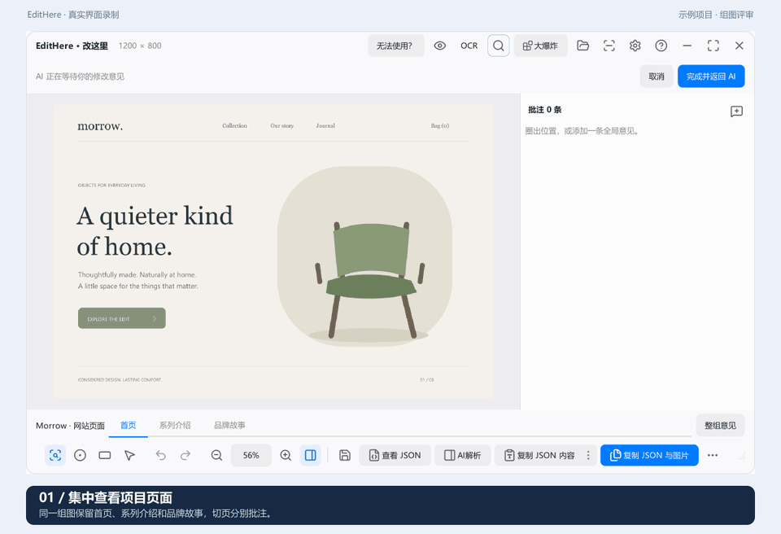
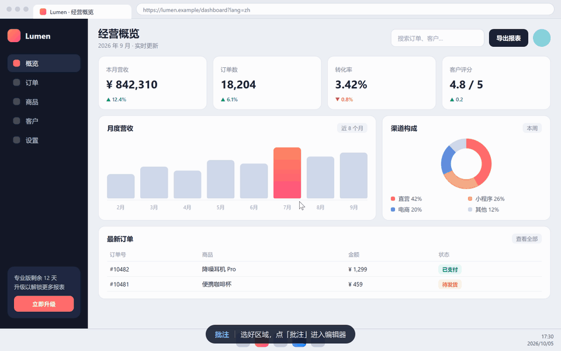
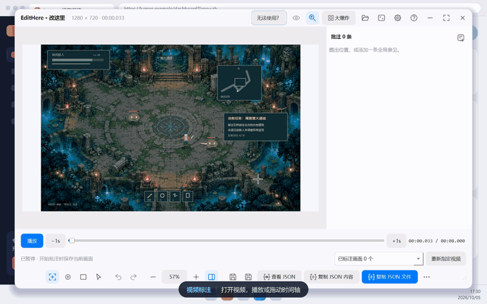
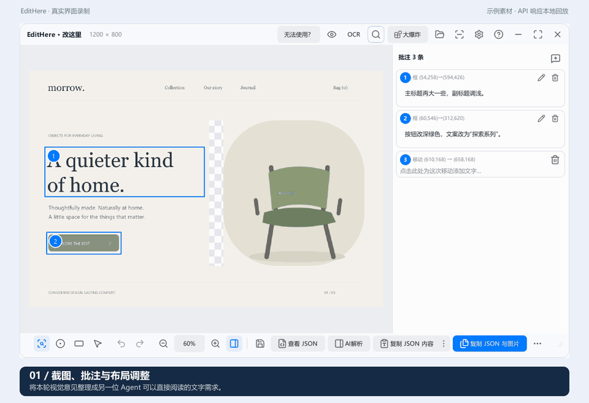
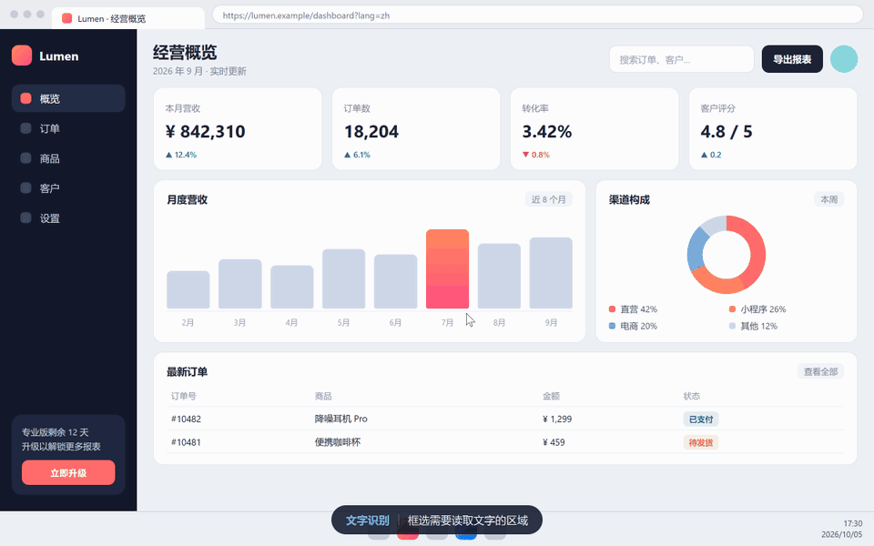
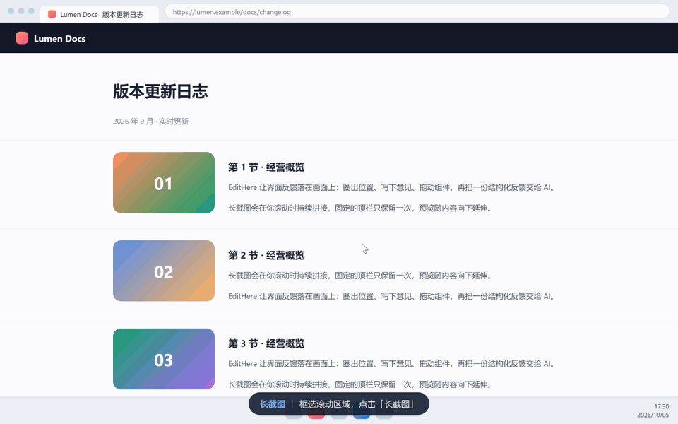

<p align="center">
  
</p>
<h1 align="center"><picture><source media="(prefers-color-scheme: dark)" srcset="assets/brand/edithere-wordmark-light.svg"></picture></h1>
<p align="center"><b>改这里 —— 把修改意见直接标在画面上，让 AI 照着改。</b></p>
<p align="center">面向 Vibe Coding 与视觉创作的本地优先反馈工作台。<br>圈出问题、拖动布局、多页评审，把「改哪里、怎么改」交给 AI。<br><sub>网页前端 · 桌面软件 · 游戏 HUD · AI 生图 · 视频与动画</sub></p>

<p align="center">
  <a href="https://github.com/Inginnng/EditHere/releases/latest"></a>
  <a href="https://github.com/Inginnng/EditHere/releases"></a>
  
  <a href="LICENSE"></a>
  <a href="https://github.com/Inginnng/EditHere/stargazers"></a>
</p>

<p align="center"><a href="https://hellogithub.com/repository/Inginnng/EditHere"></a></p>

<p align="center">
  <a href="#快速上手"><b>快速上手</b></a> ·
  <a href="#核心功能">核心功能</a> ·
  <a href="#选择使用方式">桌面与 Web</a> ·
  <a href="#下载与安装">下载</a> ·
  <a href="#接入-ai">接入 AI</a> ·
  <a href="docs/USER-GUIDE.md">使用指南</a> ·
  <a href="CHANGELOG.md">更新日志</a>
</p>
<p align="center"><b>简体中文</b> · <a href="README.en.md">English</a></p>
<p align="center">代码托管：<a href="https://github.com/Inginnng/EditHere">GitHub</a> · <a href="https://gitee.com/InnGing/EditHere">Gitee</a> · <a href="https://atomgit.com/qq_30293075/EditHere">AtomGit</a></p>

<p align="center">
  
</p>
<p align="center"><sub><b>视觉开发闭环：</b>AI 收集画面 → 你批注 / 拖动布局 → AI 改源码 → 更新截图继续复审</sub></p>

> **0.13 系列重点：项目组图 + AI 解析**
>
> - [**项目组图**](#组图演示)：最多 64 页集中评审，支持逐页批注与整组意见；AI 修改后只替换有变化的截图，继续在同一组图中复审。
> - [**AI 解析（桌面预览功能）**](#ai-解析演示)：把截图、批注与布局调整整理成可编辑的纯文本修改清单，核对后交给目标 AI。

## 为什么需要 EditHere？

AI 已经生成了能运行的界面，细节却还差一点：按钮的位置不对、几张卡片不够协调、第三秒的字幕挡住了人物。你一眼能看出的问题，常常要用一大段文字解释；页面一多，截图和意见又散在聊天记录里。

**EditHere 把描述位置变成直接操作。** 点一下确定目标，框出修改范围，或者把组件拖到想要的位置。原图、批注编号、坐标、布局变化和视频时间戳一起交付，AI 能对照画面理解你的要求。

| 你想表达的修改 | 在 EditHere 中怎么做 |
| --- | --- |
| 「右边第二个按钮颜色不对」 | **点一下 / 框一下**，直接指向目标并写意见 |
| 「把按钮移到标题旁边」 | **大爆炸直接拖动**，记录调整前后的位置与大小 |
| 「首页、设置页和弹窗都要改」 | **项目组图集中评审**，逐页批注后一次提交 |
| 「第 3 秒的字幕需要调整」 | **暂停视频批注**，保留时间戳与对应帧截图 |
| 「目标 AI 只接收文字」 | **AI 解析为修改清单**，核对后复制纯文本 |

**同一套操作，适用于不同画面。** 网页、原生应用、游戏和生成图片都可以通过图像批注，不需要页面暴露 DOM。批注与原图分开保存，不遮住原始细节，也不绑定特定模型服务。

## 快速上手

<a id="让-ai-发起一轮修改"></a>

### 推荐：让 AI 发起项目评审

**先配置一次。** 将下面这段话复制给能操作本机终端与文件的 AI 工具：

```text
请按 https://github.com/Inginnng/EditHere/blob/codex/native/docs/AI-SETUP.md 帮我配置 EditHere 和当前 AI 工具的 edithere skill。
优先复用本机已有程序；没有时再安装。完成后验证 CLI 能运行、skill 能被发现，并告诉我如何开始标注。
```

使用 Web Agent 时，按[接入 AI](#接入-ai)中的对应提示词配置，无需安装桌面程序。

**开始多页评审。** 配置完成后，在项目对话中说：

```text
用 EditHere 收集这个项目全部已实现且可访问的页面，组成组图让我评审。
等我提交后按意见修改，并更新有变化的截图供我复审。
```

只想调整单页，也可以直接说：

> 用 EditHere 让我标注一下首页，等我完成后按我的意见修改。

接下来按同一条流程推进：

1. **AI 准备画面**：运行项目，收集可访问页面的真实截图，打开组图。
2. **你集中评审**：翻页、圈选问题或拖动布局，点「完成并返回 AI」。
3. **AI 修改并交回复审**：读取反馈、修改源码并验证，只替换有变化的截图，再打开同一组图。

这条流程由配套 skill 协调当前 Agent 完成，需要 Agent 具备项目运行、截图与改码能力。普通浏览器兼容入口及部分宿主需要提交后回到原对话说「继续」，详见[网页版说明](web/README.md)。

<a id="自己打开画面批注"></a>

### 也可以自己截图或导入素材

1. 从[下载与安装](#下载与安装)获取桌面版，或解压 Web 包后双击 `EditHere.html`。
2. 拖入或粘贴图片，也可以打开视频；桌面版按 `Alt + Shift + 2` 截图，按 `Alt + Shift + 1` 新建空白批注窗口。
3. 使用智能选块、点批注、框批注或全局意见；开启「大爆炸」可直接调整组件的位置与大小。
4. 选择「复制 JSON 与图片」交给 AI，或用可选的「AI解析」整理成文字。保存项目后可随时继续编辑。

macOS 的全局快捷键为 `Option + Shift + 2` 和 `Option + Shift + 1`。快捷键可在设置中修改。

## 核心功能

### 项目组图：一次看完多个页面

把首页、设置页、游戏 HUD 和关键状态放进同一组图，最多 64 页集中查看。支持页面重命名、排序和增删，既能逐页批注，也能用「整组意见」提出跨页面的要求。

- **一次提交，按页落实**：AI 根据页面身份与批注找到对应源码，整组意见可覆盖共享组件或多页样式。
- **沿用同一组结果复审**：页面保持固定 ID，修改后只替换有变化的截图，其余页序和画面继续保留。
- **减少重复图片传递**：反馈只附有批注或实际布局变化的页面；其他页面保留轻量索引，减少无关图片占用 AI 上下文。
- **跨入口使用同一流程**：桌面、离线 Web、Web Agent、MCP Apps、桌面连接器和 DSH 共用组图反馈规则。

保存的项目仍保留全部页面与草稿。页面清单与多轮评审说明见[项目组图与结果审批](docs/PROJECT-REVIEW.md)。

<a id="组图演示"></a>

<p align="center"></p>
<p align="center"><sub>示例页面：逐页批注 → 整组意见 → 提交反馈 → 更新截图后复审。实际项目的截图与源码修改由配套 Agent 完成。</sub></p>

### 大爆炸：直接拖出想要的布局

布局要求可以直接做在画面上。点击「大爆炸」，将画面按候选区域拆成可操作的矩形块，选中后拖动、调整尺寸、等比缩放，或输入精确位置与大小；`Ctrl` / `⌘` + 点击可多选，一起调整。

**移动和缩放本身就是修改意见。** 即使没有补写文字，也会记录原始区域与最终位置；已有批注可以随组件移动，支持撤销、重做和复位。

<p align="center"></p>

<details>
<summary>布局调整如何落实到实际页面？</summary>

大爆炸移动的是图像中的矩形像素区域，原位置会留下透明空洞。AI 读取原图与布局变化后，结合项目实现修改源文件或重新生成内容。EditHere 本身不改写页面代码，不做语义抠图或自动补背景。

</details>

### 图片批注：点、框、智能选块与全局意见

- **智能选块**：悬停查看候选区域，滚轮切换更大或更小的范围，点中后写意见。
- **点批注**：精确指向某个位置。
- **框批注**：手动画出需要修改的区域。
- **全局意见**：描述整张画面的要求。

每条意见带编号，与画面位置对应。原图保留，批注与坐标独立导出；也可以复制带编号和意见的批注图片，方便对照。

<p align="center"></p>

### 视频批注：把意见放到对应时间点

打开视频，播放或拖动时间轴，暂停在需要修改的画面上批注。继续播放后，可以在另一个时间点添加意见；点击已标注时间点即可回看。

导出内容带时间戳、帧截图和该帧的批注，适合动画、游戏演示与交互流程走查。只有真正添加批注或布局变化的画面才进入反馈，单纯暂停不会产生空帧。

支持的格式取决于平台解码能力，常见输入包括 MP4、MOV、WebM。EditHere 用于记录修改意见，不执行视频剪辑或渲染。详见[视频标注说明](docs/VIDEO-ANNOTATION.md)。

<p align="center"></p>

### AI 解析：把图文意见整理成纯文本（桌面预览功能）

把视觉意见整理成修改文档，再交给只接收文字的 AI：在编辑器底部或「查看 JSON」中点击「AI解析」，即可将截图、批注和布局调整整理成可编辑的文字需求，核对后复制给目标 Agent，或保存为 TXT / Markdown。

- **目标对话更轻量**：图像在独立 API 请求中理解，复制给目标 Agent 的内容只含整理后的文字。
- **按需配置服务**：内置 OpenAI、Claude、DeepSeek、GLM、Kimi 及自定义兼容服务预设，支持修改模型、地址和系统提示词。
- **主动开始，核对后使用**：在「设置 → AI 接口」保存自己的 API Key，点击「开始解析」才发送本次图文，并消耗所选服务商的 API 额度。

直接让当前 Agent 读取图片与 JSON 时，无需为 EditHere 另配模型 API。解析结果仍需核对，详见[AI 解析说明](docs/AI-INSTRUCTIONS.md)。

<a id="ai-解析演示"></a>

<p align="center"></p>
<p align="center"><sub>真实界面录制，API 响应用本地示例回放，不调用付费服务；展示解析、核对、编辑与复制流程。</sub></p>

<details>
<summary>发送哪些图片，API Key 存在哪里？</summary>

组图解析只发送有批注或布局调整的页面；只有整组文字意见时不附截图，较大的请求按页分批。打开解析窗口不会发送请求；「测试连接」只发送内置小图。

密钥通过 QtKeychain 存入系统凭据库，不写进项目、批注 JSON 或普通设置文件。系统凭据库不可用时会报错，不回退到明文存储。

</details>

### 桌面截图、贴图、取色与长截图

**截图与贴图**：全局快捷键冻结屏幕，悬停查看候选区域，也可以手动拖框。确定选区后，可直接批注、识别文字、长截图、置顶贴图、保存或复制；截图样式支持圆角、边框与阴影。

<p align="center"></p>

**文字识别（OCR）**：框选文字后逐行查看，点击结果可高亮原图中的位置，支持复制全部或单行。批注区域也可自动识别文字，帮助 AI 确认区域内容。Windows 使用系统 OCR，macOS 使用 Vision，Linux 使用已安装的 Tesseract，识别在本机完成。

<p align="center"></p>

**长截图**：框选滚动区域，边滚动边拼接，支持双向采集、裁剪和进入批注；自动滚动与采集方式因平台而异，详见[长截图说明](docs/LONG-CAPTURE.md)及 [Linux 说明](docs/LINUX.md)。

<p align="center"></p>

<details>
<summary>更多桌面功能</summary>

- 放大镜显示像素坐标与 RGB / HEX / HSV / HSL 颜色读数，按 `C` 进入取色并复制颜色值。
- 截图选区支持固定比例、输入精确尺寸，以及按像素调整。
- 最近 20 张截图与 10 个选区跨会话保留，可恢复上次选区。
- 置顶贴图支持缩放、旋转、翻转和透明度调整，可同时保留多张。
- 浅色 / 深色主题，简体中文 / 繁體中文 / English 界面，22 项可配置快捷键与可定制底部工具栏。
- 托盘常驻，可设置登录启动；Windows 可分别配置托盘单击与双击动作。

完整操作见[使用指南](docs/USER-GUIDE.md)。

</details>

## 选择使用方式

按使用场景选择入口：

- **日常截图、OCR、长截图与贴图 → 桌面版**：全局快捷键随时唤起，配合 CLI / skill 发起评审。
- **免安装、打开即用 → 离线 Web**：双击 `EditHere.html` 开始批注，也可以部署到静态站点。
- **在 AI 客户端内批注 → Web Agent**：支持 MCP Apps 时内嵌显示，否则使用本机浏览器兼容入口。
- **DeepSeek Harness 用户 → DSH 入口**：本机组图服务、CLI 与配套技能，见 [DSH 说明](dsh/README.md)。

<details>
<summary><b>桌面版与 Web 版完整能力对比</b></summary>

| 能力 | 桌面版 | Web 版 |
| --- | --- | --- |
| 点、框、智能选块与全局意见 | 支持 | 支持 |
| 大爆炸布局调整 | 支持 | 支持 |
| 项目组图与整组意见 | 支持 | 支持 |
| 视频按时间点批注 | 支持 | 支持，格式依浏览器解码能力 |
| 系统截图、长截图、置顶贴图与托盘 | 支持，具体行为依平台 | 使用已有图片；DSH 入口另有浏览器截屏 |
| 本地 OCR 与批注区域文字 | 支持，Linux 需安装 Tesseract | 可导入、编辑已有识别结果，无内置 OCR |
| AI 解析为纯文本 | 可选，需自行配置 API | 尚未接入 |
| 与 Agent 配合 | skill + CLI，或桌面 MCP 连接器 | Web Agent / MCP Apps；离线页手动导出 |
| 保存项目 | `.edithere` | `.edithere-web.json` |
| 离线批注与导出 | 支持 | 独立 HTML，无 CDN 和外部运行时依赖 |

两端可以通过反馈 JSON 与配套图片交付意见，**项目文件格式独立**，Web 暂不直接打开桌面 `.edithere` 项目。视频项目保存已标注帧与编辑状态，不打包整段源视频。

</details>

## 下载与安装

| 版本 | 下载 | 使用方式 |
| --- | --- | --- |
| **Windows x64 安装版 · 推荐** | [**安装器 EXE**](https://github.com/Inginnng/EditHere/releases/latest/download/EditHere-win-x64-setup.exe) | 当前用户安装，无需管理员权限，可配置 PATH 与快捷方式 |
| Windows x64 免安装版 | [ZIP 压缩包](https://github.com/Inginnng/EditHere/releases/latest/download/EditHere-win-x64.zip) | 完整解压，运行 `EditHere.exe`，保留 DLL 与插件目录 |
| macOS 通用版 · 预览 | [Apple Silicon / Intel DMG](https://github.com/Inginnng/EditHere/releases/latest/download/EditHere-macos-universal.dmg) | 将 `EditHere.app` 拖入 Applications，要求 macOS 14+ |
| Linux x86_64 · 预览 | [AppImage](https://github.com/Inginnng/EditHere/releases/latest/download/EditHere-linux-x86_64.AppImage) | 赋予执行权限后运行，目标环境 Ubuntu 24.04 |
| 离线 Web | [Web ZIP](https://github.com/Inginnng/EditHere/releases/latest/download/EditHere-web.zip) | 解压后双击 `EditHere.html`，无需安装桌面程序 |
| Web Agent | [Web Agent ZIP](https://github.com/Inginnng/EditHere/releases/latest/download/EditHere-web-agent.zip) | 用于 MCP Apps 与本机浏览器会话，见[安装指南](web/AI-SETUP.md) |

以上为最新正式版下载入口，版本与资产以 [Releases](https://github.com/Inginnng/EditHere/releases/latest) 和包内 `version.txt` 为准；校验文件见 [SHA256SUMS.txt](https://github.com/Inginnng/EditHere/releases/latest/download/SHA256SUMS.txt)。

<details>
<summary>平台要求与升级说明</summary>

- **Windows**：最低构建目标为 Windows 10 1809+，主要在 Windows 11 开发与测试。免安装版无需另装 Qt、Python、Node 或 .NET；CLI 可直接通过完整路径调用。
- **安装选项**：默认目录为 `%LOCALAPPDATA%\Programs\EditHere`。安装器可配置登录启动、PATH 与快捷方式；更改 PATH 后需重新打开终端和 AI 工具。
- **Windows 更新**：应用内更新验证项目签名与 SHA-256；项目签名不是 Windows 公开信任证书，首次运行仍可能出现系统提示。0.12.7 及更早版本需手动升级一次，详见[本地通信与更新验证](docs/SECURITY.md)。
- **macOS**：预览版尚未 Apple 公证，实机覆盖有限。首次截图需屏幕录制权限，读取系统元素边界需辅助功能权限；普通图片导入不需要这两项权限。
- **Linux**：X11 与 Wayland 的截图、长截图和自动滚动能力不同；OCR 依赖本机 Tesseract，详见 [Linux 说明](docs/LINUX.md)。
- **Web Agent**：MCP Apps 需要 Node.js 20+；普通浏览器兼容 CLI 支持 Node.js 18+，均无需桌面 EditHere。单独使用离线 HTML 不需要 Node.js。

</details>

## 接入 AI

### 让 AI 帮你配置

桌面版可直接复制[快速上手](#快速上手)里的配置提示词，完整说明见 [AI 安装指南](docs/AI-SETUP.md)。

**希望免安装使用桌面版时：**

```text
请按 https://github.com/Inginnng/EditHere/blob/codex/native/docs/AI-SETUP.md 帮我配置 EditHere 免安装版和 edithere skill。
优先复用已有解压目录；需要时下载官方完整 ZIP。使用 CLI 的绝对路径，不运行安装器，不修改 PATH 或开机启动。
完成后验证 CLI 与当前 AI 工具的技能配置。
```

**使用 Web Agent 时：**

```text
请按 https://github.com/Inginnng/EditHere/blob/codex/native/web/AI-SETUP.md 帮我配置 EditHere Web Agent。
先检查已有安装，需要时下载官方 Web Agent ZIP、核对 SHA-256，并完整解压到长期保留的目录。
配置当前宿主的 Web MCP 和 edithere-web skill，验证实际工具发现与内嵌界面。
宿主不支持 MCP Apps 时使用普通浏览器兼容入口，保留现有 MCP 与技能配置。
```

仅有网页聊天、无法访问你电脑的 AI 工具不能代为安装本机程序；仍可手动接收导出的反馈。

### 已安装程序，直接调用

桌面 CLI 可以接收图片、视频、项目或组图清单，发起后等待用户提交：

```text
edithere-cli annotate "<素材或项目清单的绝对路径>" --output "<新的反馈 JSON 绝对路径>"
```

每轮使用新的反馈路径。需要可回传的会话时使用 `annotate`；`open` 用于打开浏览，不会建立等待提交的会话。

| 接入方式 | 说明 |
| --- | --- |
| [桌面 skill 与 CLI](docs/AGENT-CLI.md) | AI 发起批注、等待完成、读取 JSON 与图片 |
| [桌面 MCP 连接器](connector/README.md) | 提供 `edithere_annotate_start` / `edithere_annotate_poll` 等工具，需已安装桌面程序 |
| [Web Agent / MCP Apps](web/README.md) | 通过 `edithere_web_open` / `edithere_web_read` 使用内嵌界面或本机浏览器会话 |
| [DSH 组图入口](dsh/README.md) | 本机服务 + CLI + `edithere-dsh` 技能，面向多页面静态截图 |

远程开发可以把截图下载到本地批注，再把 JSON 与配套图片传回远程项目，详见 [VS Code Remote SSH 使用方式](docs/AGENT-CLI.md#vs-code-remote-ssh远程项目与本地-windows-标注)。

## 反馈如何交给 AI？

当前 Agent 可以直接读取结构化反馈，手动聊天也可以复制图片或文字。按接收方的能力选择：

| 交付动作 | 内容 | 适合场景 |
| --- | --- | --- |
| **完成并返回 AI** | 提交会话，供发起方读取图片与反馈 | Agent 发起的单页修改与多轮组图评审 |
| **复制 JSON 与图片** | 结构化意见 + 独立原图 | 手动交给支持读图的 AI |
| **复制带批注图片** | 带编号和意见的可视化图片 | 快速对照问题，与 AI 或同事沟通 |
| **复制 JSON 内容** | 纯 JSON，默认不带原图编码，可在「⋯」切换 | 已有画面上下文，需要坐标与批注 |
| **AI 解析** | 可编辑的纯文本修改清单 | 交给只接收文字的 AI，或保存为修改文档 |

<details>
<summary><b>开发者：反馈 JSON 示例与坐标规则</b></summary>

图片反馈采用 `feedback-minimal-4`。下面是一条布局修改的字段示意，省略原图描述：

```json
{
  "schemaVersion": "feedback-minimal-4",
  "tool": { "name": "EditHere", "version": "0.13.0" },
  "annotationSpace": "result",
  "objects": [
    {
      "id": "o1",
      "kind": "region",
      "source": { "x1": 600, "y1": 80, "x2": 800, "y2": 140 },
      "movement": {
        "rect": { "x1": 320, "y1": 80, "x2": 520, "y2": 140 },
        "dx": -280,
        "dy": 0
      },
      "annotations": [{ "number": 1, "text": "把按钮移到标题旁边" }]
    }
  ]
}
```

`source` 定位该移动组件的原始区域，`movement` 记录最终目标和位移，`annotations` 保留用户意见与编号。坐标以图像像素为单位，不能直接当作 CSS 像素；普通批注与子批注的坐标规则见[反馈 JSON 说明](docs/USER-GUIDE.md#反馈-json)。

默认文件交付为 JSON + 同目录原图，也可以选择将原图内嵌。原图描述包含尺寸与 SHA-256，便于核对图片；视频使用 `video-feedback-1`，组图使用 `image-set-feedback-1`，页内复用图片反馈格式。新程序兼容读取旧反馈，旧程序不保证能读取新格式。

完整定义见[图片反馈 Schema](schema/feedback-minimal-v4.schema.json)、[视频反馈 Schema](schema/video-feedback-v1.schema.json)和[组图反馈 Schema](schema/image-set-feedback-v1.schema.json)。

</details>

## 常见问题

<details>
<summary><b>能自动识别所有界面元素吗？</b></summary>

不能。候选区域来自本地图像分析，以及桌面端可用的系统元素边界，不等于语义识别，也不直接包含源码组件或 DOM。没有选准时可以手动画框或框出组件。

</details>

<details>
<summary><b>图片和批注会上传吗？</b></summary>

截图、选块、OCR、批注与布局调整在本机完成。使用「AI解析」并点击开始后，本次图文会发送到你配置的 API；「测试连接」只发送程序内置的小图。把反馈交给外部 AI 后，数据如何处理取决于该工具。桌面更新检查会联网查询发行信息，可在设置中关闭启动检查。

</details>

<details>
<summary><b>一定要配置模型 API 才能用吗？</b></summary>

不需要。批注、布局调整、导出和 Agent 读取反馈都可以直接使用。只有可选的桌面「AI解析」需要自己的 API Key 与额度，程序不提供模型额度。

</details>

<details>
<summary><b>能保存后继续改吗？</b></summary>

可以。桌面保存为 `.edithere`，Web 保存为 `.edithere-web.json`，保留原图、批注和布局状态；组图项目保留全部页面。视频项目保留已标注帧，继续播放时需要对应源视频。

</details>

<details>
<summary><b>点「完成」后，AI 一定会自动继续吗？</b></summary>

桌面 CLI 可等待提交后返回；MCP Apps 是否能发送消息并继续处理取决于宿主能力。普通浏览器兼容入口通常需要回到对话说「继续」。反馈保存成功与 AI 已经执行修改是两个状态，详见[网页版说明](web/README.md)。

</details>

## 文档与开发

| 文档 | 内容 |
| --- | --- |
| [使用指南](docs/USER-GUIDE.md) | 完整操作、设置、快捷键与反馈字段 |
| [项目组图与结果审批](docs/PROJECT-REVIEW.md) | 页面清单、增量换图与多轮评审 |
| [AI 安装指南](docs/AI-SETUP.md) | 桌面程序与 skill 配置 |
| [AI 与命令行](docs/AGENT-CLI.md) | CLI 命令、Agent 接入与远程开发 |
| [AI 解析](docs/AI-INSTRUCTIONS.md) | API 配置、纯文本输出与使用边界 |
| [网页版说明](web/README.md) / [Web 安装指南](web/AI-SETUP.md) | 离线 HTML、MCP Apps 与浏览器兼容入口 |
| [DSH 组图批注](dsh/README.md) | 本机会话、截图导入、CLI 与技能 |
| [视频标注](docs/VIDEO-ANNOTATION.md) / [长截图](docs/LONG-CAPTURE.md) | 时间点反馈与滚动采集 |
| [Linux 说明](docs/LINUX.md) | AppImage、OCR 与 X11 / Wayland 差异 |
| [构建与开发](docs/DEVELOPMENT.md) | C++20 + Qt 6.8+、构建、测试与打包 |
| [平台与分发目录](docs/DISTRIBUTION.md) | 各平台产物与分发结构 |
| [更新日志](CHANGELOG.md) | 各版本变更记录 |

参与开发见[贡献指南](CONTRIBUTING.md)和[贡献者许可协议](CLA.md)。

## 反馈与交流

- [报告问题或提出建议](https://github.com/Inginnng/EditHere/issues)：请附上系统版本、程序版本、复现步骤，以及方便分享的截图或示例项目。
- QQ 群 **1018416966**（反馈专用），加群时请说明来自 GitHub。
- 商业合作：**<inginnng@163.com>**。

感谢 [LINUX DO](https://linux.do/)、[HelloGitHub](https://hellogithub.com/repository/Inginnng/EditHere) 社区及所有贡献者的建议与反馈。

<p align="center">
  <a href="https://linux.do/"></a>
  &nbsp;&nbsp;&nbsp;&nbsp;&nbsp;&nbsp;&nbsp;&nbsp;
  <a href="https://hellogithub.com/repository/Inginnng/EditHere"></a>
</p>

## 作者的话

我是印迹，学生个人开发者。

做它的原因很直接：Vibe Coding 时 AI 像一台许愿机，一句话就能变出能跑的界面；可一旦要改细节，想法很清楚，但要表达就很困难。于是我想，能不能把需求直接标在图上——哪一块、多大、往哪挪，让想法先被看见，再被实现。EditHere 就是这个想法的产物。

如果你觉得它有用，欢迎在 GitHub 点一个 Star，或把遇到的问题提给我。感谢使用它的你。

## 许可与商业合作

EditHere 的原创软件采用 [PolyForm Noncommercial License 1.0.0](LICENSE)（SPDX: `PolyForm-Noncommercial-1.0.0`），属于源码可用许可。非商业用途的使用、修改与分发需遵守许可证并保留相应声明；商业用途需另行取得作者书面授权。详见[使用许可](LICENSING.md)与[商业授权与合作](COMMERCIAL-LICENSE.md)。

名称与标识的使用见[商标与品牌政策](TRADEMARK-POLICY.md)，Qt、MinGW、QtKeychain 等组件遵循各自许可证，见[第三方声明](packaging/THIRD-PARTY-NOTICES.md)。

## Star History

<p align="center">
  <a href="https://star-history.com/#Inginnng/EditHere&Date">
    <picture>
      <source media="(prefers-color-scheme: dark)" srcset="https://api.star-history.com/svg?repos=Inginnng/EditHere&type=Date&theme=dark">
      <source media="(prefers-color-scheme: light)" srcset="https://api.star-history.com/svg?repos=Inginnng/EditHere&type=Date">
      
    </picture>
  </a>
</p>
